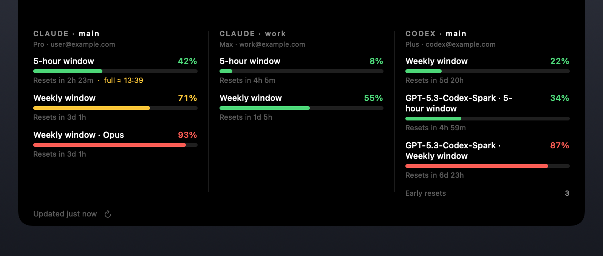
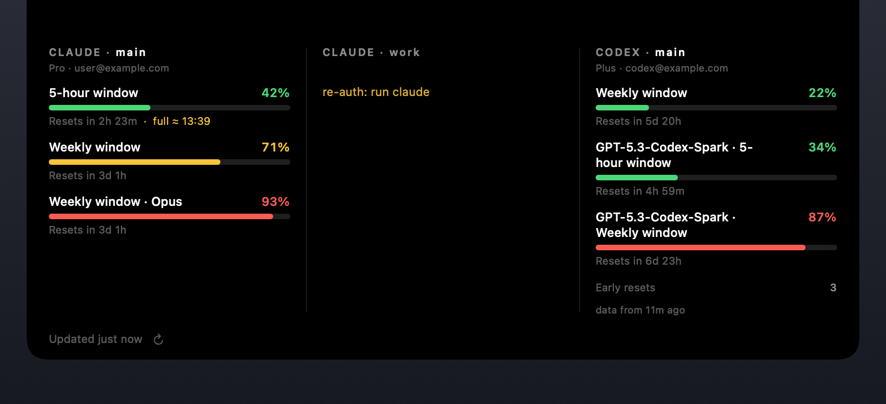

# Notchlimits

[English](README.md) · **Русский**

Панель, выезжающая из челки MacBook, с лимитами **Claude Code** и **Codex** (OpenAI). Нативное macOS-приложение на Swift/SwiftUI, собирается одним скриптом, без Xcode-проекта.



*Скриншоты — на сгенерированных данных: почты, окно `Opus` и проценты условные, это не реальный аккаунт.*

## Что умеет

- Колонка на каждый аккаунт — все профили Claude и Codex сразу.
- Набор окон лимитов не зашит в код: рисуется всё, что вернул API, включая окна, которых не было вчера.
- Живёт в челке: свёрнутая панель совпадает с вырезом пиксель в пиксель и не видна.
- Работает и без челки (внешний монитор, Mac mini, iMac).
- **Keep Awake** (контекстное меню): «Не давать Mac уснуть» и «Не гасить экран» — два независимых режима на штатных
  power assertions IOKit, без пароля администратора. Состояние видно капсулами в подвале панели.
- **Индикаторы питания и портов** в подвале панели: заряд и температура аккумулятора, порт зарядки (MagSafe / USB-C)
  с мощностью, занятые USB-C. По наведению — договорённость с зарядкой, протоколы портов, здоровье аккумулятора. Читается из IORegistry, пока панель открыта; без
  аккумулятора индикатор батареи не показывается. Правый клик → **Настройки** → **Показывать телеметрию**
  скрывает эти индикаторы и останавливает их опрос. Выбор сохраняется после перезапуска; по умолчанию телеметрия включена.
  Подробности можно открыть нажатием на индикатор или открыть панель горячей клавишей и выбрать индикатор через **Tab**.
  На узкой панели индикаторы занимают отдельную строку, не разрывая подпись времени обновления.
- Уведомления при пересечении 80 % и 95 % по любому окну и когда заметно израсходованное окно сбрасывается и освобождается.
- Прогноз исчерпания: если при текущем темпе окно упрётся в 100 % раньше сброса, строка показывает когда.
- Обновления через Sparkle: **Проверить обновления…** получает подписанный appcast с GitHub, проверяет архив по Ed25519, устанавливает приложение и перезапускает его. Проверка остаётся ручной.
- Переживает перезапуск: последние проценты кэшируются и показываются с пометкой возраста.
- Ошибка или лимит одного аккаунта не трогает остальные колонки.
- Интерфейс на 14 языках, выбирается по языку системы.
- Длинные названия окон переносятся, а не режутся, — панель подрастает под них.

## Требования

- macOS 13 и новее
- Swift 5.9 и новее (Xcode Command Line Tools)
- `claude` и/или `codex` CLI с выполненным входом

## Сборка и запуск

```bash
./build.sh && open build/Notchlimits.app
```

`build.sh` делает `swift build -c release`, собирает `build/Notchlimits.app` с `Info.plist` (`LSUIElement = true`, `CFBundleIdentifier = dev.ustinoff.notchlimits`) и подписывает бандл. Приложение фоновое — иконки в доке и меню-баре нет; выход через контекстное меню панели.

Перезапуск после пересборки:

```bash
pkill -x Notchlimits; open build/Notchlimits.app
```

DMG для установки перетаскиванием (приложение и ярлык на `Applications`) пакуется из собранного бандла:

```bash
./scripts/build_dmg.sh   # → build/Notchlimits-<версия>.dmg
```

## Как пользоваться

| Действие | Что происходит |
| --- | --- |
| Навести курсор на челку | Панель раскрывается |
| Увести курсор | Закрывается через 0,1 с |
| Клик по панели | Закрепить раскрытой |
| Повторный клик, клик мимо, **Esc** | Закрыть |
| **⌘P** (настраивается) | Открыть/закрыть из любого приложения |
| Правый клик | Контекстное меню |

На экране без челки панель живёт в верхнем центре; в свёрнутом виде — маленькая пилюля с точкой на каждый аккаунт, цвет точки показывает самое загруженное окно:


Контекстное меню сгруппировано разделителями: **О программе Notchlimits** (нативная панель с текущей версией); **Обновить** (принудительный опрос, минуя таймеры и бэкофф), **Настройки**, **Проверить обновления…** (подписанные обновления через Sparkle); **Аккаунт Claude** и **Аккаунт Codex** (переключение аккаунта приложения и **Добавить аккаунт…**), **Удалить аккаунт** (с подтверждением — удаляет вход и профиль аккаунта); **Скрыть колонку**, **Переименовать колонку**, **Показать скрытые колонки**; **Выйти из Notchlimits**. В **Настройках** — **Показывать телеметрию**, **Не давать Mac уснуть**, **Не гасить экран**, **Запуск при входе** (`SMAppService`) и **Горячая клавиша**.

## Имена колонок

Основной профиль обоих провайдеров подписан `main`, чтобы заголовки не расходились на «CLAUDE · main» и «CODEX · default». Дополнительные профили берут имя папки. Переименовать любую колонку — правый клик → **Переименовать колонку**; пустое поле возвращает имя профиля. Имя хранится в `UserDefaults` отдельно от идентификатора колонки, поэтому переименование не роняет кэш и уведомления.

## Горячая клавиша

По умолчанию — **⌘P**. Это глобальный хоткей, поэтому пока Notchlimits запущен, он перехватывает «Печать» в других приложениях — и настраивается: правый клик → **Настройки** → **Горячая клавиша**:

- **Изменить…** ловит следующее нажатие. Нужен хотя бы один модификатор ⌘, ⌥ или ⌃, иначе глобальный хоткей перехватывал бы обычный ввод.
- **Стандартная (⌘P)** / **Выключить** (оставить только наведение и клик).

Привязка идёт к физическому коду клавиши, раскладка на неё не влияет. Если сочетание занято, панель скажет об этом и оставит прежнюю настройку.

## Языки

14 языков: английский, русский, украинский, немецкий, французский, испанский, португальский (Бразилия), итальянский, польский, турецкий, японский, корейский, китайский упрощённый и традиционный. Выбирается по списку предпочитаемых языков системы; запасной — английский. Только LTR: макет не зеркалится, поэтому иврит и арабский намеренно не добавлены.

Проверить любой язык, не меняя системные настройки:

```bash
./build/Notchlimits.app/Contents/MacOS/Notchlimits -AppleLanguages "(ja)"
```

Единственный источник правды по переводам — `Tools/make-strings.py`; он раскладывает их по `Resources/<язык>.lproj/Localizable.strings` и падает, если ключ забыт или лишний. Времена и знак процента тоже локализованы: `42 %` во французском, `42%` в японском, `%42` в турецком.

## Размеры панели

Ширина — 250 pt на колонку, но не меньше 500 pt и не шире экрана минус 40 pt. Высота подстраивается под содержимое: названия вроде «GPT-5.3-Codex-Spark · Недельное окно» переносятся, а не режутся, — вёрстка сообщает реальную высоту, и окно меняет размер под неё, в пределах 252–560 pt.

## Состояния колонок



- **Свежие данные** — прогресс-бар и время до сброса. Зелёный до 60 %, жёлтый 60–85 %, красный выше.
- **`re-auth: запусти claude` / `codex`** — годного токена нет и продлить его нечем: refresh-токен отсутствует или отвергнут (Claude), либо авторизации нет или она протухла (Codex).
- **`данные N мин назад`** — серая пометка: свежего ответа нет (лимит, сеть, только что запустились), показаны последние значения.
- **`обновляю…`** — данных ещё не было.

Сообщение про re-auth или ошибку показывается **поверх** кэшированных цифр, а не вместо них: иначе протухший токен выглядит просто как старые проценты и непонятно, что надо перелогиниться.

Каждая строка держит короткую локальную историю своего процента (в `UserDefaults`, без токенов). По этим замерам методом наименьших квадратов считается **прогноз исчерпания**: если при текущем темпе окно упрётся в 100 % *раньше* сброса, к строке сброса дописывается `· предел ≈ <время>` жёлтым, а если до этого меньше 45 минут — красным. Обратный отсчёт до сброса при этом виден всегда, а точная дата предела — по наведению. Плоские и падающие окна, а также те, что успевают сброситься, показывают просто строку сброса. Прогнозу нужно несколько замеров с разбросом хотя бы в пять минут, поэтому он появляется не сразу после запуска.

Под окнами перечисляются дополнительные цифры, если эндпоинт их отдал: баланс кредитов, доступные досрочные сбросы, расход сверх плана. Строки с нулём или без значения не показываются.

## Переключение активного аккаунта

Правый клик → **Аккаунт Claude** или **Аккаунт Codex** переключает аккаунт Desktop. Claude Desktop использует отдельную папку данных Electron на аккаунт. Codex меняет только credentials в настроенном хранилище основного CODEX_HOME, сохраняя проекты и треды. Его переключение Desktop/CLI не зависит от настройки Claude «Переключать CLI».

**Настройки → Переключать CLI** по умолчанию включено: вместе с Claude Desktop выбирается существующий профиль Claude Code. При выключенной настройке меняется только Desktop, выбор CLI сохраняется. Токены между аккаунтами не копируются, дополнительный вход в Notchlimits не нужен. Точная строка пути, включая завершающий слеш и варианты симлинков, сохраняется: CLI выбирает ту же запись Keychain. Подготовленный выбор CLI публикуется только после успешного запуска Desktop; ошибка запуска оставляет маршрутизацию CLI прежней. Перед публикацией повторно проверяются наличие аккаунта и точное соответствие пути CLI: удаление во время запуска сохраняет прежний выбор CLI и сообщает ошибку его переключения, а маркер успешно открытого Desktop сохраняется. При завершении запуска настройка CLI проверяется повторно, в том числе если её включили во время запуска. Одновременные переключения одного приложения отклоняются.

При первом переключении CLI приложение добавляет строку подключения в `.zshrc` (для bash — в `.bashrc` и существующий файл запуска login shell), сохраняя существующее содержимое. Один раз откройте новый терминал. Shell-функция читает выбранный профиль при каждом новом запуске `claude` и работает при закрытом Notchlimits. Запущенные CLI-сессии сохраняют свой аккаунт. Явные `CLAUDE_CONFIG_DIR` и `CLAUDE_SECURESTORAGE_CONFIG_DIR` имеют приоритет. Если выбранная папка удалена, команда завершается ошибкой вместо входа в другой аккаунт. Для других оболочек доступно переключение только Desktop.

## Несколько аккаунтов

Меню → **«Добавить аккаунт Claude…»** или **«Добавить аккаунт Codex…»**. Диалог просит короткое имя профиля и сразу показывает результат (`Папка: ~/.claude-profiles/work`); кнопка «Создать» неактивна, пока имя не годится. Панель создаст `~/.claude-profiles/<имя>` (или `~/.codex-profiles/<имя>`), положит туда `login.command` и откроет его в Terminal.app. Пароли панель не спрашивает и не видит — вход делает CLI. Новые профили подхватываются автоматически, без перезапуска. Профиль, у которого вход не завершён, виден в **«Удалить аккаунт»** как «… — вход не выполнен» — так можно удалить и ошибочно созданный.

То же руками:

```bash
CLAUDE_CONFIG_DIR=~/.claude-profiles/work claude
CODEX_HOME=~/.codex-profiles/work codex login
```

Бинарники ищутся не по `PATH` (у GUI-приложения он почти пустой), а по известным местам: `~/.local/bin`, `~/.claude/local`, `/opt/homebrew/bin`, `/usr/local/bin`, расширение VS Code `anthropic.claude-code-*` и `/Applications/ChatGPT.app` для `codex`.

## Источники данных

**Claude Code.** Credentials читаются из Keychain (generic password, служба `Claude Code-credentials`; дополнительные профили — `Claude Code-credentials-<hash>`, где hash — sha256 от `CLAUDE_CONFIG_DIR`) или нативного macOS fallback-файла `.credentials.json` в каталоге CLI. Файловые профили участвуют в обнаружении, продлении, переключении Desktop/CLI и явном удалении. Продление сохраняет результат в исходном хранилище, сохраняет неизвестные поля и права файла 0600. Удаление основного аккаунта очищает оба хранилища credentials, сохраняя остальные настройки CLI.

```
GET https://api.anthropic.com/api/oauth/usage
Authorization: Bearer <accessToken>
anthropic-beta: oauth-2025-04-20
User-Agent: claude-code/<версия CLI из пути установки>
```

Родной `User-Agent` важен — без него эндпоинт заметно чаще отвечает 429. Любое поле-объект с числовым `utilization` считается окном, поэтому новые окна появляются сами, включая внутренние кодовые имена моделей. Инертные окна — `0 %` **и** без даты сброса, как заглушка `nimbus_quill`, которую эндпоинт отдаёт про запас, — скрываются, пока не оживут: незачем занимать место строкой, с которой ничего не сделать. Названия: `five_hour`/`seven_day` — понятные подписи; известные префиксы разворачиваются (`seven_day_opus` → «Недельное окно · Opus», показывается на планах с Opus); остальное показывается словами, а не сырым snake_case. `extra_usage` (доплата за расход сверх плана) в окна не попадает — это деньги, а не доля квоты — и уходит в строку статистики, но **только пока `is_enabled: true`**: тогда `used_credits` — живой счётчик потраченного (показывается как сумма: значение минорное, `10308` при `decimal_places: 2` — это `103.08 $`, плюс месячный потолок `monthly_limit`, если задан). Когда доплата выключена (`out_of_credits`), то же число — просто исторический остаток израсходованных кредитов и выглядело бы как активный счёт, поэтому строка скрывается.

Подзаголовок — `план · почта`, как у Codex. План (`Pro`, `Max`) — из записи Keychain; почты нет ни в одном эндпоинте, поэтому читаем её прямо из конфига CLI — `~/.claude.json` (или `<CLAUDE_CONFIG_DIR>/.claude.json` для доп. профилей), поле `oauthAccount.emailAddress`. Это обычное чтение файла, без Keychain и подпроцессов, поэтому диалог пароля не всплывает.

### Обновление токена

Токен доступа Claude живёт несколько часов. Если CLI не запускать, он протухает и колонка замирает — поэтому, когда токен просрочен, а в записи credentials лежит живой `refreshToken`, панель продлевает его сама, ровно как это делает CLI:

```
POST https://platform.claude.com/v1/oauth/token
Content-Type: application/json

{"grant_type": "refresh_token", "refresh_token": "…",
 "client_id": "9d1c250a-e61b-44d9-88ed-5944d1962f5e", "scope": "<права из записи>"}
```

`client_id` — публичный идентификатор клиента Claude Code, секрета в нём нет. Права берутся из самой записи, а не зашиты в код, чтобы набор не сузился молча.

Три неочевидные детали:

- **Refresh-токен ротируется.** Когда в ответе приходит новый, старый тут же перестаёт работать, поэтому результат записывается обратно в исходное хранилище credentials: без записи сломался бы вход самого CLI. Запись накладывается на *свежепрочитанную* запись, сохраняя `subscriptionType`, `rateLimitTier` и все поля, о которых панель не знает.
- **Обновлённые credentials сохраняются, когда сервер вернул refresh-токен.** Иначе новый access-токен остаётся в памяти. Перед HTTP-запросом проверяется право тихой записи в Keychain: без него продление откладывается до расходования refresh-токена.
- **401 помечает именно этот токен как отвергнутый**, чтобы следующий заход обновлял его, а не перечитывал из Keychain тот же мёртвый. Если в записи оказался другой токен — значит, CLI обновился первым, и берётся он.

Продление происходит при истечении токена или после usage 401, напрямую по HTTP, без фонового запуска Claude. Для автопродления нужен Claude Code 2.1.278 или новее. Обе нативные OAuth-блокировки удерживаются от повторного чтения credentials до сохранения результата; отдельный heartbeat поддерживает их во время запроса. Запись дополнительно берёт `.storage-write.lock`. Занятая или потерянная блокировка откладывает обновление. Если запись ротированных credentials не удалась, OAuth-блокировки сохраняются и повторяется только запись. Обычный выход ждёт завершения продления; если за 25 секунд сохранить credentials не удалось, выход отменяется, а запись продолжает повторяться. OS file lock на стабильном служебном файле подтверждает живого владельца Notchlimits. Неизменяемый маркер extended attribute записывается в отдельный пустой каталог до атомарной публикации нативного lock-пути без замены существующего владельца. Авария во время подготовки не оставляет нативный lock без маркера; heartbeat его не переписывает, а каталог остаётся совместимым с нативным rmdir. Старые JSON-записи владельца поддерживаются. Recovery читает маркер через открытый дескриптор каталога и перед удалением проверяет, что нативный путь всё ещё указывает на тот же inode. Блокировки CLI и чужие замены сохраняются. Явное удаление сначала берёт обе OAuth-блокировки и storage-блокировку. Если их держит нативный CLI, удаление сообщает о занятости и предлагает повторить попытку; собственную блокировку продления Notchlimits можно временно использовать для синхронного удаления. Если каталог CLI определить нельзя, удаление завершается ошибкой вместо обхода блокировок. Успешное явное удаление аккаунта очищает его pending-credentials и делает поздние ответы refresh недействительными; отказ удаления сохраняет токены и повторные попытки записи. Успешное удаление также выводит из использования и удаляет управляемый каталог Desktop. Повторное добавление того же CLI-профиля получает новый каталог Desktop, даже если старый процесс заново создаст прежний путь. Уже подготовленный запуск сохраняет маркер фактически открытого Desktop и не может переключить CLI на повторно добавленный аккаунт. Повторно добавленный вход дожидается завершения старого поколения и разрешает собственные credentials. Захват OAuth- и storage-блокировок не создаёт удалённый дополнительный профиль заново; автоматически создать можно только основной каталог конфигурации. Результат usage принадлежит поколению колонки, начавшему запрос, поэтому поздний ответ не перезаписывает колонку, кэш, историю и расписание нового аккаунта. Внутри критического участка диалоги Keychain запрещены. Сетевая ошибка и региональный/proxy 403 не стирают вход. Блокировки профилей независимы. С более старым или неопознанным CLI лимиты опрашиваются, пока токен годен; после истечения нужен вход через CLI.

Синхронизация действует в рамках нативного протокола блокировок CLI: она не даёт атомарного compare-and-swap Keychain против произвольного внешнего писателя или процесса, остановленного дольше срока блокировок.

**Codex.** Корневая настройка `cli_auth_credentials_store` выбирает для каждого `CODEX_HOME` режим `file`, `keyring` или `auto`; по умолчанию используется `file`. Прямое хранилище macOS Keychain использует нативный сервис `Codex Auth` и ключ `cli|` с первыми 16 hex-символами SHA-256 канонического пути CODEX_HOME. `auto` сначала читает Keychain, затем `auth.json`, если запись отсутствует или недоступна. Продление сохраняет результат в том же backend, откуда прочитан grant: отказ Keychain сохраняет ротированные токены для повторной записи без нового refresh POST. Продление резервирует профиль от первого чтения до сохранения результата или отбрасывания устаревшего ответа. Переключение Desktop/CLI сообщает о занятости, пока у затронутого профиля есть незавершённый refresh или несохранённая ротация. Успешное удаление выводит резерв из использования: поздний ответ не может заменить pending-credentials повторно добавленного профиля. Отказ удаления сохраняет их. Обнаружение читает только метаданные Keychain. Конфигурацию разбирает полноценный TOML decoder, включая многострочные строки, quoted/dotted keys и inline tables. Учитываются системный конфиг, legacy managed config, локальные requirements и принудительные настройки macOS; отдельные аргументы запуска CLI этому процессу неизвестны. Дополнительный encrypted secrets backend явно отклоняется, чтобы не принять его за прямое хранилище Keychain. Режим `ephemeral` живёт только в памяти процесса Codex: Notchlimits не читает память другого процесса, игнорирует оставшиеся постоянные credentials и отклоняет постоянное переключение в этом режиме. Дополнительный вход в Notchlimits не нужен. Авторизация из выбранного хранилища; режим `apikey` до usage-эндпоинта не дотягивается — нужен вход через ChatGPT. Срок жизни токена — из claim `exp` в JWT, e-mail для подписи колонки — из `id_token`.

```
GET https://chatgpt.com/backend-api/wham/usage
Authorization: Bearer <access_token>
ChatGPT-Account-ID: <account_id>
User-Agent: codex_cli_rs/<версия>
```

Рисуются `rate_limit.primary_window`, `secondary_window` и все `additional_rate_limits[]` — последние с префиксом из `limit_name` либо `metered_feature`. Эти доп. записи — отдельные лимиты по конкретным моделям, которые API отдаёт помимо основной квоты (например `GPT-5.3-Codex-Spark` — отдельный тир модели); приложение показывает те имена, что пришли, так что список следует за OpenAI без правок кода. Название окна выводится из `limit_window_seconds` (`18000` → 5-часовое, `604800` → недельное). Подзаголовок — `plan_type · почта`; `credits.balance` и `rate_limit_reset_credits.available_count` становятся строками статистики (число доступных «полных сбросов» — как в самом приложении ChatGPT; `applicable_available_count` не используем, он равен 0 даже когда все кредиты доступны).

## Обновление и устойчивость

- Каждый аккаунт опрашивается независимо раз в 3 минуты, со сдвигом 4 с — не залпом.
- При раскрытии панели обновляются только колонки старше двух минут.
- Таймаут запроса 10 с, один ретрай на 5xx и сетевую ошибку.
- **HTTP 429 не ошибка.** Пауза берётся из `Retry-After`, иначе растёт 2 → 4 → 8 → 15 минут; в колонке остаются последние данные с пометкой возраста.
- Последние успешные значения кэшируются в `UserDefaults` и показываются сразу после перезапуска.
- Уведомление о пороге срабатывает один раз за окно и перевзводится, когда меняется `resets_at` (началось новое окно). Когда окно, дошедшее до ≥ 50 %, сбрасывается, приходит пуш «лимит сброшен» — был затык, стало свободно.

## Разрешения

- **Keychain.** При первом обновлении Claude macOS спросит доступ к `Claude Code-credentials` — нажми **«Разрешать всегда»**. Keychain перечитывается на каждом цикле, чтобы заметить новый вход CLI; действующий токен не продлевается без необходимости. Запись при продлении не вызывает диалог.
- **Подпись.** Релизы используют закреплённый сертификат Apple Development `a.a.ustinoff@gmail.com`. `build.sh` выбирает именно его, в том числе для помощников Sparkle. Локально без него используется ad-hoc. При переходе с ad-hoc или другой подписи может понадобиться новое разрешение Keychain; следующие релизы сохраняют требование к тому же сертификату.
- **Уведомления.** Запрашиваются при первом запуске.
- **Accessibility не нужен** — хоткей на Carbon `RegisterEventHotKey`, а вход запускается `.command`-файлом, а не AppleScript.

## Приватность

Автоматические запросы ограничены описанными выше usage-эндпоинтами и продлением токенов. Обновления проверяются вручную: Sparkle получает подписанный `appcast.xml` с GitHub по клику и скачивает архив после выбора **Установить обновление**. Автоматическая проверка и системное профилирование по умолчанию выключены. Подпись архива проверяется до распаковки. Токены не логируются. Обновлённый токен Claude записывается обратно в ту же запись Keychain или нативный fallback-файл, которыми владеет CLI; запись Codex следует его настройке хранилища. Бинарь `claude` не запускается вовсе (его запуск заставляет CLI читать креды через `/usr/bin/security` — а это диалог пароля Keychain): версию для User-Agent берём из пути установки, почту — из конфига CLI `~/.claude.json`. Автоматически запускается только `codex --version`. Credentials Codex остаются в настроенном файле с правами 0600 или прямом хранилище Keychain. При переключении они переносятся между явно настроенными хранилищами источника и назначения; резерв основного аккаунта сохраняет исходный backend. На диск идут только настройки и последние проценты со временем сброса — в `UserDefaults`, без единого токена. Для usage-запросов `URLSession` работает в ephemeral-режиме, без кук и дискового кэша.

## CI и релизы

[`.github/workflows/ci.yml`](.github/workflows/ci.yml) — на каждый push в `main`, каждый PR и по кнопке: генерация переводов и проверка, что `Resources/*.lproj` не разошлись, `plutil -lint` строк, проверка генератора иконки (валидный `.icns`), `./build.sh`, самопроверка и проверки бандла (`Info.plist`, подпись, `LSUIElement`, иконка, все 14 локализаций), затем загрузка `.app` артефактом.

Самопроверка (`NOTCHLIMITS_SELFTEST=1`) не требует ни сети, ни Keychain, ни оконного сервера и покрывает разбор ответов Claude/Codex (мусор, `null`-окна, неизвестные ключи), порядок и названия окон, claims JWT, форматирование времени/возраста/процентов, сериализацию кэша и хоткея, полноту локализаций — одинаковый набор ключей, отсутствие пустых значений и **совпадение спецификаторов формата с английским**, иначе `String(format:)` уронил бы приложение на чужом языке.

Регрессионный набор запускается командой `PYTHONDONTWRITEBYTECODE=1 python3 -m unittest discover -s Tools -p 'test_*.py'`.
Он компилирует код Swift с искусственными ответами API/Keychain и временными профилями, проверяет шаги релиза до
подписи и обновление времени сброса и возраста данных без нового ответа usage.
Двум UI-проверкам нужна сессия рабочего стола macOS; набор не обращается к API и не использует реальные учётные данные.

[`.github/workflows/release.yml`](.github/workflows/release.yml) запускается по заранее созданному тегу `v*` или вручную из `main` с версией существующего тега. Проверка из защищённой `main` сверяет тег и его push-CI; подпись требует подтверждения в environment `release`. Сборка использует проверенный SHA, импортирует закреплённый сертификат Apple Development во временную связку ключей, запускает самопроверку, пакует DMG и ZIP, подписывает DMG и appcast ключом Sparkle и публикует их с `SHA256SUMS.txt`. Перед публикацией удалённый тег сверяется повторно. Sparkle использует DMG; ZIP остаётся для перехода со старого установщика. В `CFBundleVersion` записывается номер запуска workflow. Требования к секретам и ключам описаны в [инструкции релиза](docs/RELEASE.md).

Версия берётся из `NOTCHLIMITS_VERSION`, иначе из файла [`VERSION`](VERSION):

```bash
NOTCHLIMITS_VERSION=1.2.0 ./build.sh    # сборка
git tag v1.2.0 && git push origin v1.2.0    # релиз
```

## Отладочные режимы

Переменные окружения для запуска бинарника напрямую (`./build/Notchlimits.app/Contents/MacOS/Notchlimits`):

| Переменная | Что делает |
| --- | --- |
| `NOTCHLIMITS_PROBE=1` | Проверяет хоткеи и парсер Claude, опрашивает реальные аккаунты, печатает результат без GUI |
| `NOTCHLIMITS_RENDER=<папка>` | Рендерит `panel.png`, `states.png`, `collapsed.png` — картинки этого README |
| `NOTCHLIMITS_SNAPSHOT=<файл.png>` | Снимает реальное окно панели (не требует «Записи экрана») |
| `NOTCHLIMITS_MOCK=1` | Мок-данные вместо провайдеров |
| `NOTCHLIMITS_SELFTEST=1` | Оффлайн-самопроверка для CI, ненулевой код при провале |
| `-AppleLanguages "(ja)"` | Аргумент, не переменная: запуск на выбранном языке |

## Иконка

`Resources/AppIcon.icns` не хранится «как есть» — рисуется кодом:

```bash
swift Tools/make-icon.swift
```

Скрипт отрисовывает все десять размеров iconset и собирает `.icns` через `iconutil`, палитра полос та же, что в `Theme.swift`.

## Устройство

```
Sources/Notchlimits/
  App/        точка входа, делегат, контекстное меню, отладочные режимы
  Notch/      геометрия челки, NSPanel, hover-логика и анимации
  UI/         SwiftUI-вёрстка панели
  Model/      типы колонок и окон лимитов
  Providers/  Claude (Keychain + api.anthropic.com), Codex (файл/Keychain + chatgpt.com)
  Core/       планировщик опроса, кэш, история + прогноз, уведомления, хоткеи, добавление аккаунтов
Tools/
  make-strings.py   переводы для всех языков
  make-icon.swift   иконка приложения
```

Пара мест, где реализация неочевидна и менять её нужно осторожно:

- `NotchPanel.constrainFrameRect(_:to:)` возвращает рамку без изменений. Иначе AppKit сдвинет окно из-под меню-бара и панель перестанет прилипать к челке.
- Уровень окна — `.popUpMenu`, а не `.statusBar + 1`: на свежих macOS меню-бар рисуется выше, и панель оказалась бы под пунктами меню.
- `NotchHostingView.safeAreaInsets` занулён: окно само стоит поверх выреза, и добавочная safe area сдвинула бы содержимое ещё на высоту челки.
- При закрытии рамка окна ужимается на 0,35 с позже старта анимации, чтобы не срезать её последние кадры.

## Лицензия

Notchlimits — свободное ПО под [GNU General Public License v3.0](LICENSE) (`GPL-3.0-only`). Copyright (C) 2026 Anton Ustinoff.
